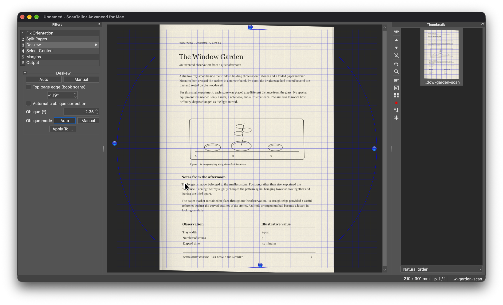

# ScanTailor Advanced for Mac

**ScanTailor Advanced for Mac** is an independent native macOS port of
[ScanTailor Advanced](https://github.com/4lex4/scantailor-advanced), an interactive
post-processing tool for scanned pages.

This fork targets **Apple Silicon (arm64) only**. It runs natively using Qt,
without Wine or Rosetta. It is not an official upstream macOS release.



## Download

Download **[1.2.1-mac.1 for Apple Silicon](https://github.com/ProbabilityEngineer/ScanTailor-Advanced-Mac/releases/tag/v1.2.1-mac.1)**.
This is upstream version 1.2.1 with Mac-port revision 1.

**This binary requires macOS 27.0 or later and an Apple Silicon Mac.**
It is Developer ID signed, Apple-notarized, and stapled. Unzip the archive,
move **ScanTailor Advanced for Mac.app** to Applications, and open it normally.
Homebrew is not required to run the release. A SHA-256 checksum is included
with the release assets.

## What it does

Split scanned spreads into pages, deskew images, select content, adjust margins,
remove backgrounds, and produce cleaned-up pages ready for printing or assembly
into a document.

ScanTailor processes existing image files. It does **not** operate scanners,
install scanner drivers, perform OCR, or assemble multipage PDFs. Scan with
macOS Image Capture or your scanner's software first.

## Provenance and credits

The original ScanTailor Advanced project is maintained at
[4lex4/scantailor-advanced](https://github.com/4lex4/scantailor-advanced).
This port was forked from
[ScanTailor-Advanced/scantailor-advanced](https://github.com/ScanTailor-Advanced/scantailor-advanced),
which is itself a fork of that project. The initial Mac build used its
v1.2.1-era commit `5eaac18`.

The macOS work adds a native app bundle, bundled Qt libraries and plugins,
an app icon derived from upstream artwork, and Mac-specific display naming.
The image-processing features and artwork remain credited to the ScanTailor
and ScanTailor Advanced contributors.

See the [preserved upstream README](README-upstream.md) for feature descriptions,
history, and upstream Windows/Linux build notes. Those platform and release
instructions describe upstream, not releases from this Mac port.

## Build and run

Requirements:

- An Apple Silicon Mac.
- Xcode Command Line Tools (`xcode-select --install`).
- [Homebrew](https://brew.sh) installed at `/opt/homebrew`.

```bash
brew install cmake qt boost jpeg-turbo libpng libtiff
git clone https://github.com/ProbabilityEngineer/ScanTailor-Advanced-Mac.git
cd ScanTailor-Advanced-Mac

cmake -S . -B build-macos-arm64 \
  -DCMAKE_BUILD_TYPE=Release \
  -DCMAKE_OSX_ARCHITECTURES=arm64 \
  -DCMAKE_PREFIX_PATH="$(brew --prefix qt);$(brew --prefix boost);$(brew --prefix jpeg-turbo);$(brew --prefix libpng);$(brew --prefix libtiff)" \
  -DBUILD_TESTS=OFF
cmake --build build-macos-arm64 --parallel "$(sysctl -n hw.ncpu)"

open "build-macos-arm64/ScanTailor Advanced for Mac.app"
```

The build deploys Qt frameworks and plugins into the app and applies an ad-hoc
signature. Copy the `.app` to Applications if desired. Keep the app bundle
intact; do not move just the executable out of it.

Local builds use ad-hoc signing; the published release is separately Developer ID
signed and notarized. The current release binary requires macOS 27.0 or later
because of its toolchain and bundled dependencies. Building for earlier macOS
versions requires compatible dependencies as well as a suitable deployment
target; earlier versions have not been validated.

### Rebuilding after a Qt update

The deployment step overwrites existing bundled libraries so that the executable
and Qt frameworks stay in sync. Mixing a newly linked executable with older
bundled Qt libraries can cause a launch-time “Symbol not found” crash.

## Scope and testing

- Native arm64 app bundle and launch tested locally.
- No Intel or universal build is maintained.
- Full image-processing regression testing and clean-machine deployment testing
  remain outstanding.
- Existing settings identifiers are retained despite the Mac display-name change.

Please report Mac-port issues in
[this repository's issue tracker](https://github.com/ProbabilityEngineer/ScanTailor-Advanced-Mac/issues),
and distinguish them from issues reproduced with upstream.

## License

GNU General Public License version 3. See [LICENSE](LICENSE).
Upstream copyright and license notices are retained.
